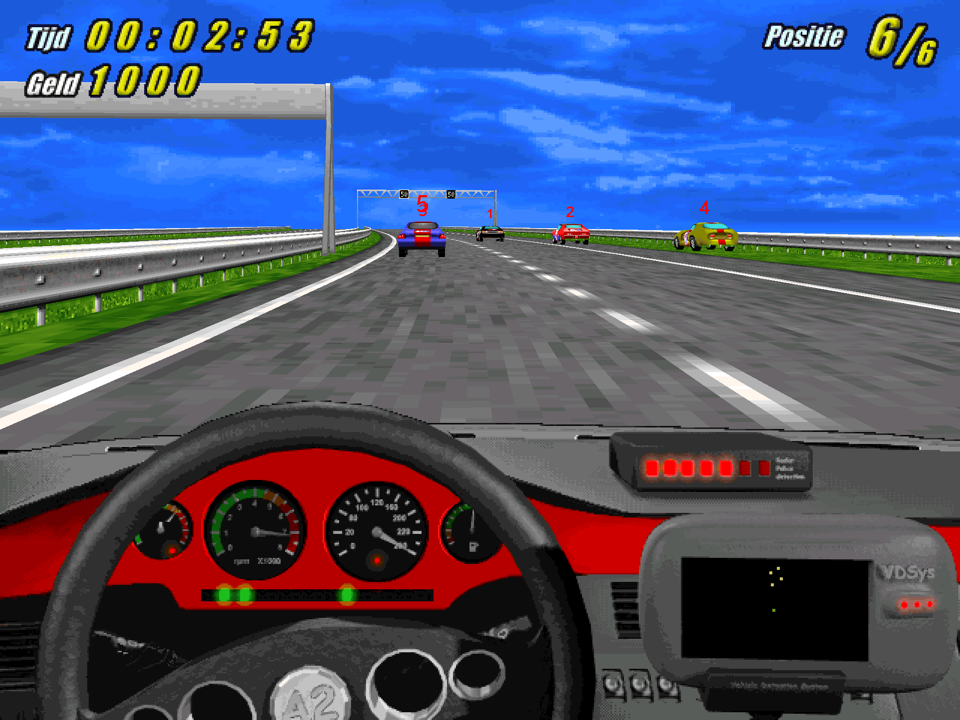
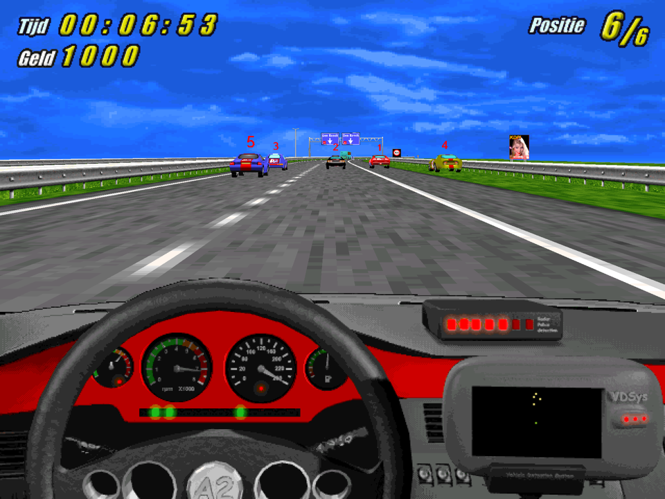
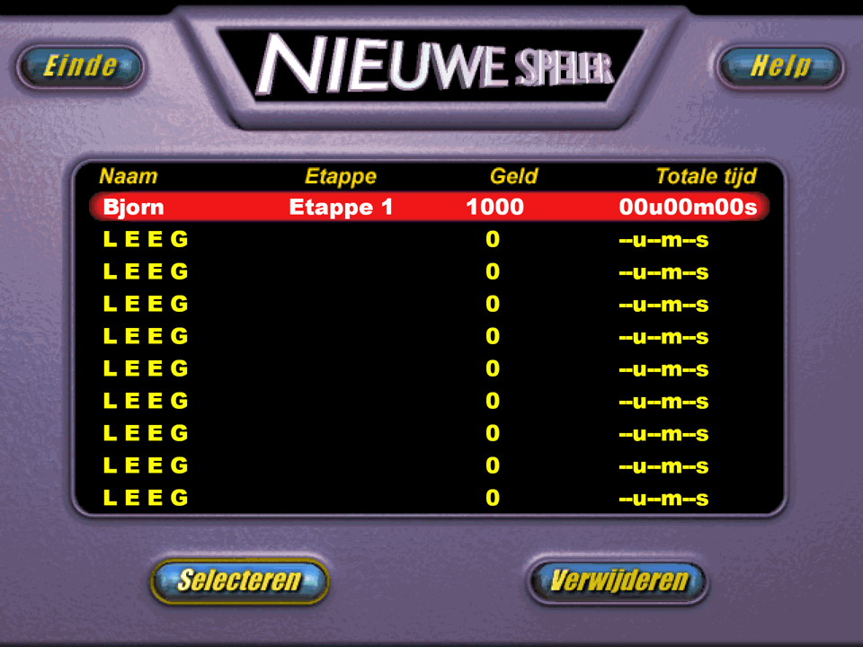

# OpenA2Racer

[](https://github.com/bjorncm/OpenA2Racer/actions/workflows/build.yml)

OpenA2Racer is an open-source reimplementation of **A2 Racer**, the Dutch
racing game Davilex released in 1997, for macOS and Windows.

It is a complete port of the original game. That covers the launcher and its
movies, the menu (players, options, controls, scores and the post-race
screens) and the race with all six stages, the computer racers, police,
traffic, pickups, HUD and sound. Saved games, options and scores keep their
original file formats. Where OpenA2Racer deliberately differs from the
original, [CHANGELOG.md](CHANGELOG.md) says so; everything else is meant to
behave as it did in 1997.

You need the original A2 Racer CD-ROM (or a copy of its files) to play. No
game data is included.

## Screenshots

| Stage 6 | Stage 2 |
|---|---|
|  |  |
| **Player screen** | |
|  | |

The screenshots show art from the original A2 Racer by Davilex. The game data
itself is not included.

## System requirements

- **macOS:** macOS 26 or later on a Mac with Apple Silicon.
- **Windows:** Windows 10 or later, on x86 (32-bit or 64-bit) or ARM64.
- **Graphics:** OpenGL 3.2. On Windows on ARM, if the graphics driver has
  no OpenGL of its own, install the OpenCL and OpenGL Compatibility Pack.
- **Disk space:** about 10 MB for the program and 54 MB for the game files
  it copies on the first start.
- **Game files:** the original A2 Racer CD-ROM, or a copy of its files.
- **Controls:** keyboard; gamepads and steering wheels should also work but are untested for now.

## Technology

- **C++20**, built with **CMake**.
- **[SDL3](https://libsdl.org)** for the window, input (keyboard, gamepads
  and wheels) and audio.
- **OpenGL 3.2 core** for all drawing. The game's 8-bit art stays 8-bit
  textures, resolved through the palette in a shader.
- **[FreeType](https://freetype.org)** for the menu text, drawn at the
  displayed size.
- **[libsmacker](https://github.com/greg-kennedy/libsmacker)** for the
  Smacker movies. CMake fetches it at a pinned commit.

The menu keeps the original 640x480 layout as logical coordinates. It is
drawn at the window's real pixel resolution and scaled to fit without
stretching, so it stays sharp on high-resolution screens. The race's 3D view
also renders at full resolution. The race logic runs at a fixed tick rate
(20 per second by default), which the original's speed depended on.

## Playing

On the first start, OpenA2Racer asks for the folder with the A2 Racer files:
the CD itself or a copy on disk. It checks the folder and copies the files it
needs (about 54 MB) to its settings folder, so after that the CD isn't
needed:

- macOS: `~/Library/Application Support/OpenA2/OpenA2/`
- Windows: `%APPDATA%\OpenA2\OpenA2\`

Saved games, options and scores are stored there too. The original files
themselves are never changed.

A start window opens before the game, with the window size, render
resolution, full screen (Alt+Enter switches while playing), an FPS counter,
the race's view distance and tick rate. From there you can also copy the game
files again, open their folder, or uninstall the game. Its texts are Dutch,
like the game.

## Building

You need CMake 3.24 or later, a C and C++20 compiler, SDL3 3.2 or later and
FreeType. The first configure downloads libsmacker with Git; pass
`-DOPENA2_LIBSMACKER_SOURCE_DIR=<checkout>` to use a local copy instead.

### macOS

With the Xcode Command Line Tools (`xcode-select --install`) and
[Homebrew](https://brew.sh):

```sh
brew install cmake sdl3 freetype
cmake -S . -B build
cmake --build build
ctest --test-dir build --output-on-failure
```

This builds `build/OpenA2Racer.app`; `build/opena2` links to the program
inside it for the command line. That app uses the Homebrew libraries. For an
app that runs on other Macs (macOS 11 or later), with the libraries inside it
and signed ad hoc, plus the installer disk image:

```sh
cmake --install build --prefix dist/macos   # OpenA2Racer.app and OpenA2Racer.dmg
```

### Windows

The Windows builds (32-bit x86 and ARM64) are cross-compiled on macOS with
[llvm-mingw](https://github.com/mstorsjo/llvm-mingw). Unpack its macOS
release to `~/Toolchains/llvm-mingw` (or set `LLVM_MINGW_ROOT`), then:

```sh
cmake -S . -B build-windows-x86 --toolchain cmake/toolchains/windows-x86.cmake \
      -DCMAKE_BUILD_TYPE=Release -DBUILD_TESTING=OFF
cmake --build build-windows-x86
cmake --install build-windows-x86 --prefix dist/windows-x86   # OpenA2Racer.exe
```

Use `windows-arm64` in place of `windows-x86` for ARM64. These builds
download the SDL3 and FreeType sources (pinned, with their hashes) and link
everything statically, so `OpenA2Racer.exe` is a single file. It needs
Windows 10 or later and OpenGL 3.2. On Windows on ARM, if the graphics driver
has no OpenGL of its own, the OpenCL and OpenGL Compatibility Pack provides
it.

### Icons

`assets/OpenA2Racer.icns` and `assets/OpenA2Racer.ico` are made from
`assets/OpenA2Racer_icon.png` with
`tools/make_icons.py assets/OpenA2Racer_icon.png assets`.

## Command-line options

```sh
opena2 [game-folder] [options]
```

| Option | Effect |
|---|---|
| `game-folder` | Use this folder with the game files as it is: no copy, no start window. |
| `--no-intro` | Skip the intro movie. |
| `--no-dialog` | Skip the start window and use the last settings. |
| `--capture <file.bmp> [seconds]` | Save the screen at the window's pixel resolution after the given time (default 1.5 s) and exit. |

For development:

| Option | Effect |
|---|---|
| `--race <stage>` | Start race stage 0-5 straight away. |
| `--race-state <n>` | With `--race`: put the race into state 3-7 or 9 (finish, police stop, time out, money out, fuel out, pause) once racing starts. |
| `--race-view <stage> [--race-piece <n>]` | Open a stage with a free camera (arrow keys, A/Z, Home/End; Esc leaves). |
| `OPENA2_RACE_AUTOPILOT=<speed>` | Hold the gas below this speed. |
| `OPENA2_FAKE_RACE` | Skip the race and write a finished result with random times. |
| `SDL_LOGGING=audio=debug` | Log the race sounds as they start. |

## Project layout

| Path | Contents |
|---|---|
| `include/opena2/`, `src/*.cpp` | The `opena2_data` library: archives, PCX and indexed images, WAV, 3D meshes, Smacker movies, saves in the original formats, installing. |
| `include/opena2/race/`, `src/race/` | The race logic, without SDL or OpenGL. |
| `src/game/` | The game: OpenGL drawing, audio, the menu screens, the race renderer, HUD and sound, and the start window. |
| `src/main.cpp` | `opena2_asset_browser`, a separate tool to view the original sprites, images and 3D models and play its sounds. |
| `tests/` | Unit tests (run with `ctest`). They don't need the game files. |
| `cmake/` | macOS app bundling, the DMG, and the Windows toolchains. |
| `tools/` | The icon maker and the [Ghidra scripts](tools/ghidra/README.md). |
| `assets/` | The OpenA2Racer icon. |

## How it was made

The game logic was ported from the decompiled original program: the
launcher `A2.EXE` and its modules `A2MENU.DAT` (menu), `A2MOVIE.DAT`
(movies) and `A2SPEL.DAT` (race). Ported routines carry the original's
function names and addresses in comments. The Ghidra scripts used for the
analysis are in [tools/ghidra/](tools/ghidra/). No original code,
decompiler output or game assets are part of this repository.

## License

OpenA2Racer is free software under the
[GNU General Public License v3.0](LICENSE).

A2 Racer and its game files belong to their respective owners. They are not
covered by this licence and are not included; you need your own copy to
play.
